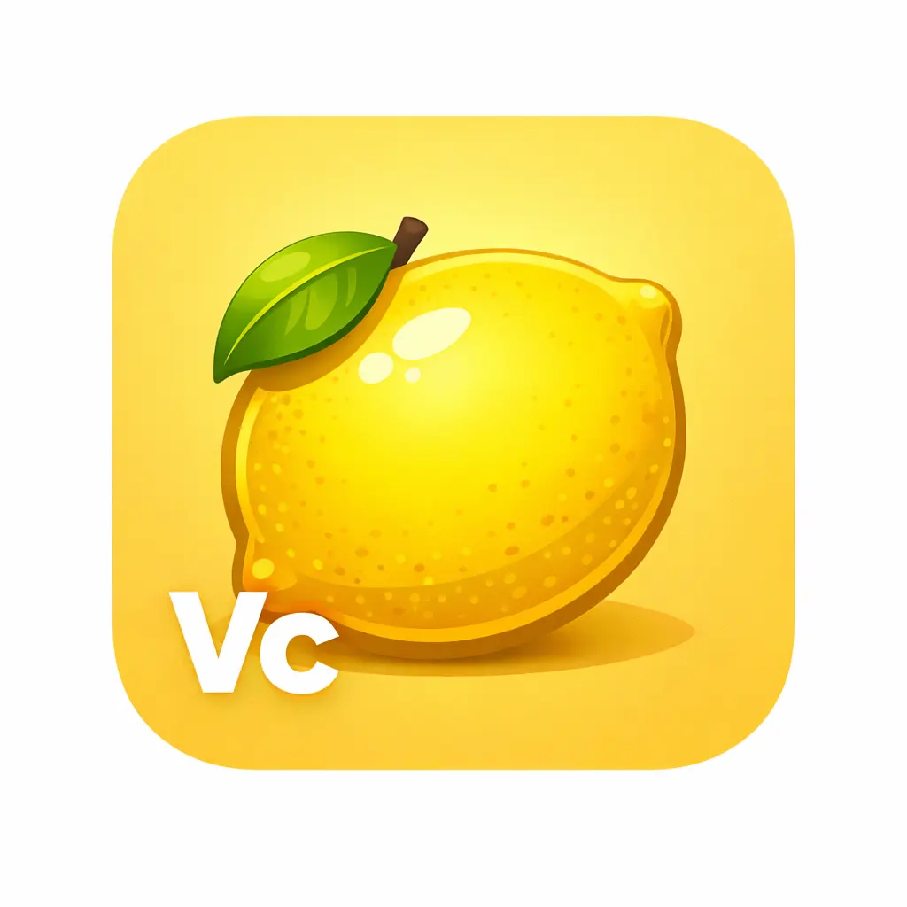
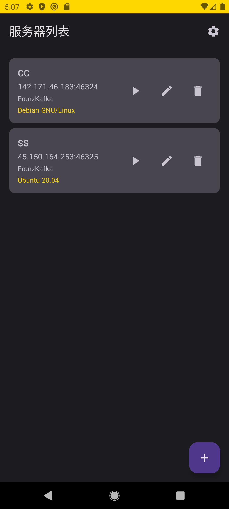
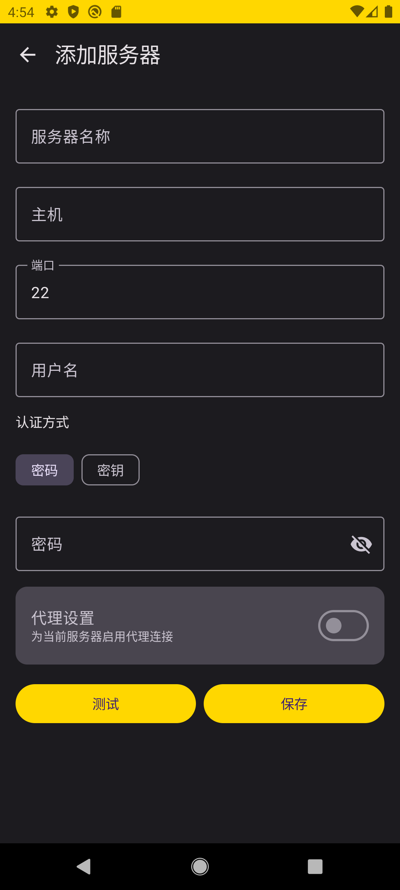
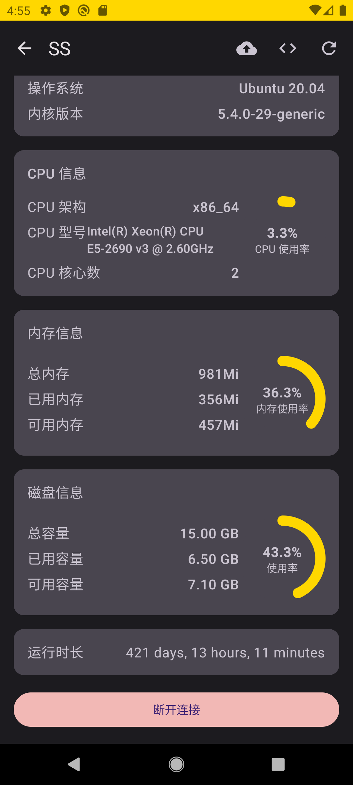
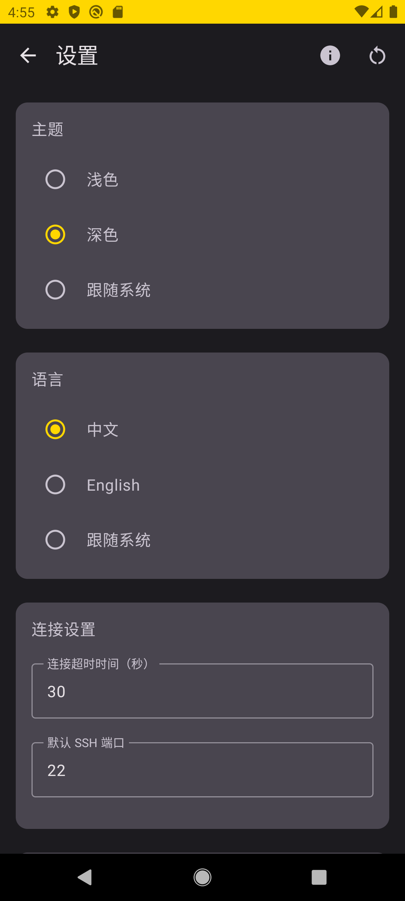
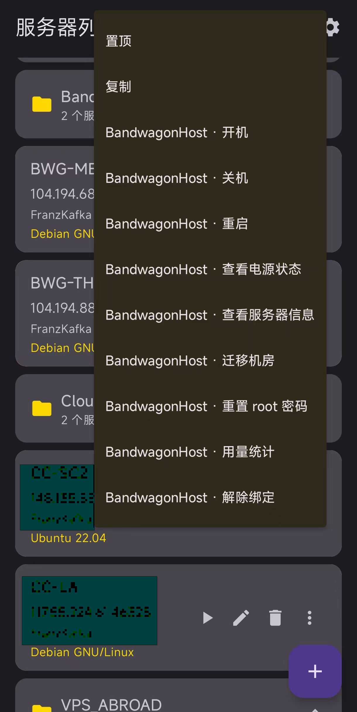
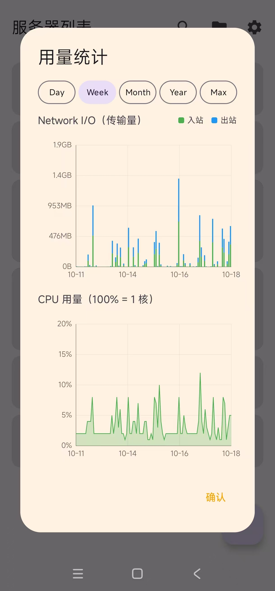

<p align="center">
  
</p>

<h1 align="center">VcServer</h1>

<p align="center"><strong>掌上 SSH，尽在掌握</strong></p>

<p align="center">简体中文 | <a href="./README_EN.md">ENGLISH</a></p>

一个 Android SSH 服务器管理应用：连接远程主机、查看状态、传输文件，并可将服务器绑定到服务器厂商管理后台。

## 📱 应用简介

VcServer 通过 SSH 连接远程服务器，执行命令、监控状态、传输文件，并进行日常运维。支持把一台服务器绑定到对应厂商，使用面板 API 做电源、信息、迁移和用量等操作。数据保存在本机，敏感信息使用 Android Keystore 加密。

## 📸 应用截图

| 列表页                             | 添加页                          |
|---------------------------------|------------------------------|
|    |  |
| **状态页**                         | **设置页**                      |
|  |    |
| **操作页**                         | **详情页**                      |
|  |  |

## ✨ 核心功能

### 🖥️ 服务器与 SSH
- 按 IP/域名、端口添加；密码或密钥认证
- 列表查看、编辑、删除、置顶、滑动删除、复制
- 添加前可测连通
- HTTP / SOCKS 代理与 SSH 跳板

### 📊 状态监控
- CPU、内存、磁盘、系统信息、运行时长
- 网卡 IP、当前登录用户
- 可配置自动刷新间隔

### 🏭 服务器厂商绑定
- 每台 SSH 服务器可绑定 **一家** 厂商（BandwagonHost、CloudCone 或 Virtualizor等）
- 解除绑定不影响已保存的 SSH 配置

### 💻 终端
- 交互式 SSH；命令历史与本地常见命令补全
- ANSI / xterm 256 色；同机多 Shell 标签
- `htop`、`vim` 等全屏程序的画面与按键
- Ctrl / Esc / Tab / 方向键栏；可调字号

### 📁 文件
- SFTP 上传、下载、创建、删除

### 🔒 安全与本地
- Keystore 加密密码与私钥
- 导入导出本机数据；不收集、不上传用户数据
- 深色 / 浅色主题；中、英文

## 🚀 快速开始

### 环境要求
- Android Studio Narwhal Feature Drop | 2025.1.2 或更高版本
- JDK 17
- Android SDK 29+
- Gradle 8.7（Kotlin 1.9.10，compile / target SDK 34，最低 Android 10）

### 构建步骤

1. **克隆项目**
   ```bash
   git clone https://github.com/FranzKafkaYu/VcServer.git
   cd VcServer
   ```

2. **打开项目**
   - 使用 Android Studio 打开项目
   - 等待 Gradle 同步完成

3. **运行应用**
   - 连接 Android 设备或启动模拟器（Android 10+）
   - 点击运行按钮或使用快捷键 `Shift+F10`

### 配置说明

应用首次运行时会自动创建本地数据库和设置存储。所有敏感信息（密码、私钥）都会使用 Android Keystore 进行加密存储。

## 🔐 安全说明

- 所有敏感信息（密码、SSH 私钥）使用 Android Keystore 进行加密存储
- SSH 连接使用标准加密协议
- 应用不收集或上传任何用户数据
- 所有数据存储在设备本地

## 👥 贡献

欢迎提交 Issue 和 Pull Request！

## ⭐Star History

[](https://www.star-history.com/#FranzKafkaYu/VcServer&type=date&legend=top-left)
